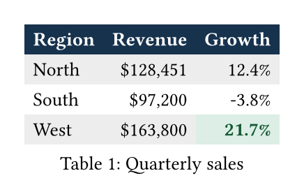

# tytable

[](https://pypi.org/project/tytable/)

Turn **Polars DataFrames** into **Typst tables** with readable Python method chains. Format values, highlight cells, group rows and columns, and add images or sparklines. Preview tables in Jupyter or include them in a Typst report. Inspired by R's [tinytable](https://github.com/vincentarelbundock/tinytable).

## Install

```sh
uv add tytable
# or: pip install tytable
```

Generated tables require **Typst 0.11.1 or newer** to compile. For generated plots and sparklines, install `tytable[images]`; embedding existing images needs no extra dependencies.

## Example

Show quarterly revenue and growth, with currency and percentage formatting and a highlighted standout result:

```python
import polars as pl
from tytable import tt
from tytable.formatters import currency, percent

data = pl.DataFrame({
    "Region": ["North", "South", "West"],
    "Revenue": [128450.75, 97200.5, 163800.25],
    "Growth": [0.124, -0.038, 0.217],
})

table = (
    tt(data, caption="Quarterly sales")
    .fmt(j="Revenue", fn=currency("USD", digits=0))
    .fmt(j="Growth", fn=percent(digits=1))
    .theme_striped()
    .style(i=2, j="Growth", bold=True, background="#dceee5", color="#145a32")
)

table.save("sales.typ")
```



Use `#include "sales.typ"` in a Typst report, or call `table.compile("sales.pdf")` to create a standalone PDF with the Typst CLI. In Jupyter, leave `table` as the last expression in a cell for an HTML preview.

## Documentation

- [Full guide](https://einmaulwurf.github.io/tytable/): tutorials, rendered examples, and an API reference, built from `main`.
- [Latest release PDF](https://github.com/EinMaulwurf/tytable/releases/latest/download/tytable-docs.pdf).
- [Coding guide for agents](docs/agent-guide.md): a self-contained reference for writing tytable code.

To build the PDF locally, run `make docs` with the [Typst](https://typst.app/open-source) and [Typstyle](https://typstyle-rs.github.io/typstyle/installation.html) CLIs installed.
